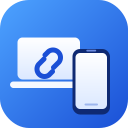

<div align="center">



# ADB Link

**One app that links your Android phone and your Linux computer — both directions.**

🖥️ control the phone from the laptop &nbsp;·&nbsp; 📱 control the laptop from the phone &nbsp;·&nbsp; 🔌 USB, Wi-Fi, Tailscale, Bluetooth

[English](README.md) · [العربية](README.ar.md)

</div>

---

## ⚡ Install (one command)

**💻 Laptop** — any Linux (Fedora, Ubuntu, Debian, Arch, openSUSE …):

```bash
curl -fsSL https://raw.githubusercontent.com/alienshtain/adb-link/main/install.sh | bash
```

It installs everything ADB Link needs (adb, GTK 4, libadwaita, scrcpy, brightnessctl, playerctl, clipboard and screenshot tools …), adds **ADB Link** to your app menu and puts the `adblink` command in your PATH. It asks for your password once.

Add `-s -- --autostart` to also start hidden at login, or `-s -- --phone` to install the phone app at the same time:

```bash
curl -fsSL https://raw.githubusercontent.com/alienshtain/adb-link/main/install.sh | bash -s -- --autostart --phone
```

**📱 Phone** — any Android 8+ phone:

| Way | How |
|---|---|
| From the laptop | Plug the phone with USB (USB debugging on) → `adblink install-phone` (or the **Link** tab → *Install*) |
| By hand | Download `adblink.apk` from the [Releases](../../releases) page and open it on the phone |

> The repository name in the commands above is `alienshtain/adb-link`. If you forked it, replace it (or set `ADBLINK_REPO=you/adb-link`).

---

## ✨ What it does

### 🖥️ From the laptop (the window)

| | |
|---|---|
| 📱 **Phone panel** | A phone-shaped panel on the right: quick settings (Wi-Fi, Bluetooth, airplane, do-not-disturb, mute …), buttons, brightness, media, screenshot, camera, mirror (scrcpy). **Arrange it yourself**: pencil → drag, ◀ ▶, ✕, **+** add anything, Reset. |
| 🔔 **Notifications** | Pull the phone's notification list and quick toggles. |
| 📞 **Calls** | Pop-up + desktop notification with *Answer* / *Reject*, optional "pause media on call". |
| 👤 **Contacts** | Call or message from the SIM through the phone. |
| 📦 **Apps** | Install / uninstall / save apps as APK (with split parts), search, filter. |
| 📁 **Files** | Browse the phone, upload files **and folders**, download, drag & drop, new folder, delete, **preview pictures and text files** (double-click, ← → to browse). |
| ⌨️ **Commands** | Your own command buttons; sort, add, edit. They also appear in the phone app. |
| 🔗 **Link** | The server the phone app talks to, pairing code, what works and what is missing, one-click install of missing tools. |
| 🔌 **Connect** | Wi-Fi / Bluetooth / USB connection helper (see below). |

### 📱 From the phone (ADB Link app)

- Run commands and a terminal on the laptop
- Mouse pad, keyboard, shortcuts and media keys; see the laptop screen
- Browse laptop files, preview pictures and text, upload / download files and folders
- Shared clipboard and notifications
- **One accent color** for all command icons (rounded, filled) — change it in Settings
- "Find my computer" button: no typing of IP addresses

---

## 🔌 Connecting the phone (Wi-Fi / Bluetooth)

Open **Connect** in the window. It does the steps for you and tells you in plain words what is wrong.

| Situation | What to do |
|---|---|
| Phone on USB | **Switch to Wi-Fi** — one click, then unplug. |
| Android 11+ without USB | Developer options → **Wireless debugging** → *Pair with code*. Put the address and code in Connect → *Pair*. Ports are filled in automatically from mDNS. |
| Away from home | Install [Tailscale](https://tailscale.com) on both; ADB Link uses the Tailscale address. |
| **Bluetooth** | adb cannot travel over Bluetooth itself. ADB Link joins the phone's **Bluetooth tethering** network (phone: *Hotspot & tethering → Bluetooth tethering*), then connects adb through it. Command: `adblink bluetooth MAC`. |
| `unauthorized` | Unlock the phone and accept the "Allow USB debugging" prompt (tick *Always allow*). |
| `failed to connect` | Press **Diagnose** — it checks network, port and adb step by step. |

Known phones are remembered and reconnected automatically.

CLI versions: `adblink connect [HOST[:PORT]]`, `adblink pair HOST:PORT CODE`, `adblink wifi`, `adblink diagnose HOST`.

---

## 🖱️ Mouse and keyboard from the phone

ADB Link creates a virtual mouse/keyboard through `/dev/uinput` — it works on **Wayland and X11**. It needs a one-time permission:

```bash
adblink setup-input
```

(or **Link → Allow**). Log out and in if it says so. If something is still missing, the phone shows a red box with the exact reason.

---

## 🧰 Commands

```text
adblink                     open the window
adblink --background        start hidden (calls and notifications keep working)
adblink server              server only, no window (SSH / headless)
adblink code                show the pairing code
adblink doctor              what is missing
adblink install-deps        install what is missing
adblink setup-input         allow phone mouse / keyboard
adblink install [--autostart] / uninstall
adblink connect | pair | wifi | diagnose | bluetooth | install-phone
```

Uninstall: `bash ~/.local/share/adblink/uninstall.sh` (add `--purge` to delete settings too).

---

## 🗂️ Project layout

```text
adb-link/
├── install.sh / uninstall.sh      one-command installer
├── assets/                        icon (SVG + PNG)
├── laptop/adblink/                the Linux app (Python)
│   ├── cli.py  connect.py  deps.py  desktop.py  phoneapp.py
│   ├── panel/                     the window (GTK 4 + libadwaita)
│   └── server/                    what the phone app talks to
├── phone/                         the Android app (Flutter + Kotlin)
├── tools/make_icons.py            builds every icon size from assets/icon.svg
├── tests/
└── .github/workflows/build-apk.yml  builds adblink.apk on every tag
```

## 🏗️ Build the phone app yourself

Needs [Flutter](https://flutter.dev) and Java 17:

```bash
bash phone/setup.sh ~/adblink-app --build
adb install -r ~/adblink-app/build/app/outputs/flutter-apk/app-release.apk
```

Or push a tag (`git tag v3.0 && git push --tags`): GitHub Actions builds the APK and attaches it to the release, and `adblink install-phone` downloads it from there.

## ⚠️ Good to know

- Linux with **GTK ≥ 4.6 and libadwaita ≥ 1.1** (Ubuntu 22.04+, Fedora 36+, Debian 12+). Older versions are handled with fallbacks.
- Android only (iPhone is not supported).
- Bluetooth works through tethering, not as a direct adb transport.
- The terminal feature gives the phone a shell on your laptop — keep it off if you share the pairing code; pairing tokens can be revoked (*Link → Unpair all*).
- Contacts / SMS use the phone's own apps and depend on the manufacturer.

## License

MIT
